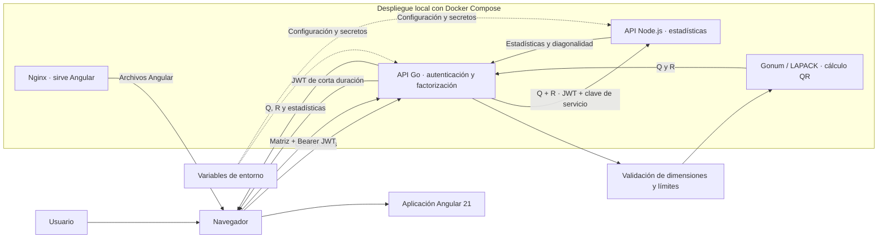

# Reto técnico

Aplicación web para factorizar matrices QR. El frontend está hecho con Angular 21, la API principal con Go/Fiber y el servicio de estadísticas con Node.js/Express. Go calcula QR mediante Gonum/LAPACK; Node analiza conjuntamente los valores de Q y R. La solución incluye autenticación JWT, pruebas automatizadas y ejecución con Docker Compose.

## Flujo general

### Arquitectura

En el despliegue local, Compose inicia primero Node, luego Go y finalmente el frontend, esperando los _health checks_ de cada dependencia. Node solo es accesible desde la red interna; Go publica su puerto y Nginx sirve la aplicación Angular. En Render, las API se despliegan como servicios separados y Angular usa las URL configuradas para producción.

1. El usuario ingresa sus credenciales en Angular. El frontend las envía a Go, que valida las credenciales de demostración y devuelve un JWT de corta duración.
2. El usuario define la matriz en una cuadrícula y solicita el cálculo. Angular envía la matriz a Go con el JWT.
3. Go valida la solicitud y los límites de tamaño, calcula `A = Q × R` y conserva las dimensiones completas definidas para Q y R, incluso para matrices rectangulares.
4. Go envía Q y R a Node para calcular mínimo, máximo, suma, promedio, cantidad de valores y diagonalidad. La integración requiere el JWT y una clave de servicio independiente.
5. Go combina los resultados y los devuelve a Angular, que presenta Q, R y sus estadísticas. Si una solicitud falla, las API responden con un error controlado y un identificador de solicitud cuando corresponde.

El contrato HTTP, las formas de las matrices y los errores están descritos en [docs/CONTRATO_API.md](docs/CONTRATO_API.md).

## Levantar todo con Docker

Requisitos: Docker Desktop o Docker Engine con Compose.

1. Se debe definir el `.env` y cambiar los valores de `JWT_SECRET`, `SERVICE_API_KEY`, `DEMO_USERNAME` y `DEMO_PASSWORD`. Genera secretos independientes y aleatorios; `JWT_SECRET` debe ser Base64 estándar de al menos 32 bytes decodificados.
2. Ejecutar `docker compose up --build` desde la raíz.
3. Abrir [http://localhost:8088](http://localhost:8088) e iniciar sesión con `DEMO_USERNAME` y `DEMO_PASSWORD` del `.env`.

Compose construye las tres imágenes, espera a que Node y Go pasen sus health checks, y publica el frontend. Nginx enruta `/go` hacia Go y `/node` hacia Node por la red privada de Compose. Go también está disponible directamente en `http://localhost:8080`; Node no publica un puerto al host.

El `.env` raíz solo configura el arranque local de Compose y está excluido de Git y de los contextos de build.

## Ejecutar las pruebas

- Go: ejecuta `go test ./...` desde `api-go`.
- Node: ejecuta `npm ci` y `npm test` desde `api-node`.
- Angular: ejecuta `npm ci` y `npm test` desde `web`.
